<!--
  Hacker-terminal profile README.
  Every panel is an animated SVG in /assets (CSS + SMIL only, no scripts), so it runs inside GitHub's .
  The snake is rebuilt every night by .github/workflows/snake.yml into the `output` branch.
-->

<a href="https://prem-arvinth-g.github.io/Online_Portfolio/">
  
</a>

<p align="center">
  <a href="https://prem-arvinth-g.github.io/Online_Portfolio/"></a>
  <a href="https://www.linkedin.com/in/prem-arvinthg/"></a>
  <a href="mailto:premarvinthg@gmail.com"></a>
  
</p>




<p align="center">
  
  
  
  
  
  
  
  
  
  
  
  
</p>


<p align="center">
  <a href="https://github.com/prem-arvinth-g/Student_Management_System_.NET"></a>
  <a href="https://github.com/prem-arvinth-g/Dress_Shop"></a>
  <a href="https://github.com/prem-arvinth-g/Automatic_Number_Plate_Recognition"></a>
  <a href="https://github.com/prem-arvinth-g/Automatic_Smart_Streetlight_Fault_Detection_and_Response_System"></a>
  <a href="https://github.com/prem-arvinth-g/Retail-Sales-Insights-using-SQL"></a>
  <a href="https://github.com/prem-arvinth-g/Online_Portfolio"></a>
</p>



<picture>
  <source media="(prefers-color-scheme: dark)" srcset="https://raw.githubusercontent.com/prem-arvinth-g/prem-arvinth-g/output/snake-dark.svg" />
  <source media="(prefers-color-scheme: light)" srcset="https://raw.githubusercontent.com/prem-arvinth-g/prem-arvinth-g/output/snake-light.svg" />
  
</picture>


<p align="center">
  <a href="mailto:premarvinthg@gmail.com"></a>
  <a href="https://www.linkedin.com/in/prem-arvinthg/"></a>
  <a href="https://prem-arvinth-g.github.io/Online_Portfolio/"></a>
</p>

<details>
<summary><code>$ cat ~/.plan</code></summary>
<br />

```diff
@@ ~/.plan · updated Oct 2026 @@
+ now      Angular screens, ASP.NET REST APIs and T-SQL stored procedures at Russell Tobin
+ like     code that's easy to read and change · APIs that behave predictably · simple screens
+ path     circuits (ECE) → dashboards (data) → full-stack .NET
+ open to  conversations about .NET and Angular work
```

</details>
